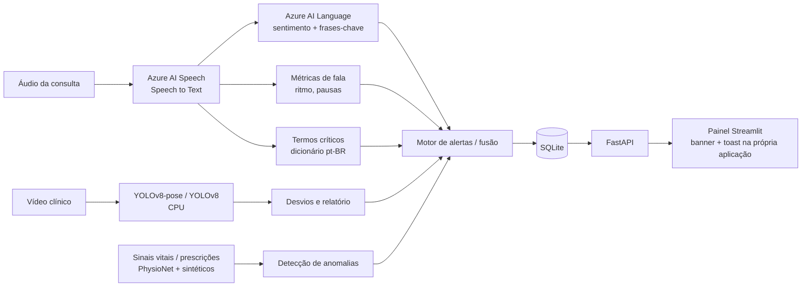

# Arquitetura

## Visão geral

| Etapa | Estado |
|---|---|
| Áudio (Speech + Language + termos + métricas + alertas) | ✅ primeiro slice |
| Alertas dentro da aplicação (API + painel) | ✅ |
| Vídeo (pose + objetos) | ⏳ `src/medmonitor/video` |
| Anomalias (sinais vitais, prescrições, movimentação) | ⏳ `src/medmonitor/anomaly` |
| Fusão multimodal / score de risco | ⏳ `src/medmonitor/fusion` |

## Decisões

- **Tudo em CPU.** Vídeo com modelos *nano* (`yolov8n`, `yolov8n-pose`), ~5 fps e frames reduzidos. Pose via YOLOv8-pose (ou MediaPipe) no lugar do OpenPose, que exige GPU/build pesado; a troca deve ser justificada no relatório.
- **Alertas na própria aplicação**, não por e-mail/Teams: o motor grava em SQLite, a API expõe `GET /alerts` e o painel consulta a cada 3 s, exibe um banner (crítico/aberto) e dispara *toast* para alertas novos; o médico confirma com **Reconhecer**.
- **Serviços atrás de interfaces** (`Transcriber`, `TextAnalyzer`): permitem testes sem Azure e o modo `MOCK_AZURE=true`.
- **Heurísticas explicáveis** (dicionário + limiares) antes de modelos opacos; os limiares ficam em `config.py`/`.env`.
- **Dados:** PhysioNet e AudioSet são públicos; prescrições e vídeos de exemplo devem ser sintéticos/públicos. Nenhum dado real de paciente.

## API

| Método | Rota | Descrição |
|---|---|---|
| GET | `/health` | Estado e modo (mock ou Azure) |
| POST | `/audio/analyze` | Multipart: `patient_id` + `file` → transcrição, análise e alertas |
| POST | `/text/analyze` | JSON `{patient_id, text}` → mesmo resultado, sem áudio |
| GET | `/alerts` | Filtros `status`, `patient_id`, `limit` |
| POST | `/alerts/{id}/ack` | Reconhece o alerta |

## Limitações a registrar no relatório

- O dicionário de termos e os limiares de ritmo de fala são ilustrativos, sem validação clínica.
- O sistema apoia a decisão da equipe médica e não substitui avaliação profissional.
- Dados pessoais de saúde são sensíveis (LGPD): o projeto usa apenas dados públicos ou sintéticos.
