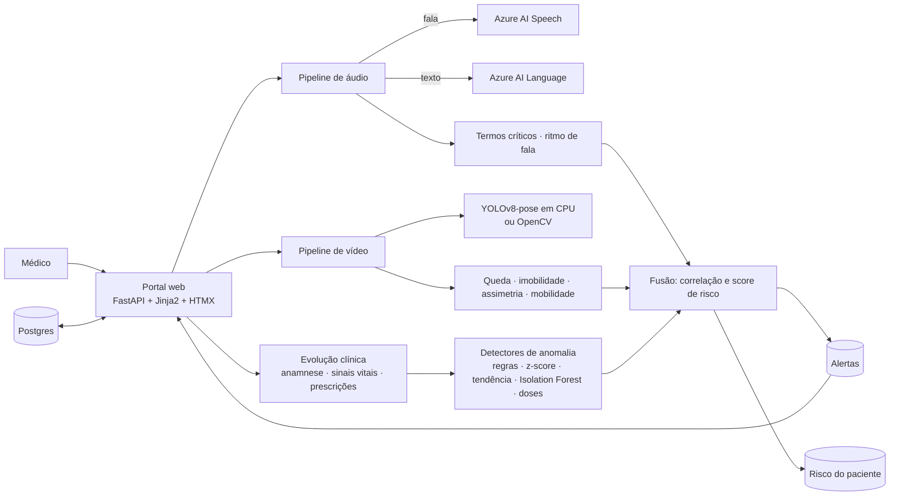

# Arquitetura

## Decisões

- **Alertas na própria aplicação**, não por e-mail/Teams: ficam no banco, o painel faz *polling* (HTMX) a cada 3 s, uma faixa vermelha avisa quando há crítico em aberto e o médico confirma com **Estou ciente** (registra quem e quando).
- **Front sem build**: FastAPI + Jinja2 + HTMX, tudo em Python. Gráficos são SVG gerados no servidor.
- **CPU**: YOLOv8n-pose (~6 MB) em quadros reduzidos a 640 px, 2 quadros/s. Sem `ultralytics`, o plano B usa subtração de fundo do OpenCV (bounding box, sem articulações).
- **Anomalias leves e explicáveis**: regras clínicas, desvio robusto (mediana/MAD) contra a linha de base do próprio paciente, tendência por regressão linear e Isolation Forest treinado na linha de base. Cada achado traz o motivo e a evidência.
- **Risco**: pontos por severidade, teto de 50 por modalidade (o score exige convergência) e nível "crítico" só com algum achado crítico. Correlações entre modalidades geram achados próprios (ex.: *piora clínica apesar do ajuste de dose*).
- **Resumo por regras**, determinístico e sem LLM, sempre com aviso de que não é diagnóstico.
- **Serviços atrás de interfaces** (`Transcriber`, `TextAnalyzer`, `PersonEstimator`): trocar Azure por simulado, ou YOLO por OpenCV, não toca no resto.
- **Dados**: SQLAlchemy 2. Postgres no Docker; SQLite local e nos testes. Seed idempotente na subida.

## Fluxo de um achado

1. Upload (áudio/vídeo) ou clique em *Analisar anomalias com IA*.
2. O módulo gera achados (`Finding`: origem, severidade, título, descrição, evidência).
3. A fusão correlaciona e calcula o risco; achados de severidade alta/crítica viram alertas (sem duplicar os que já estão em aberto).
4. O painel mostra o alerta; **Estou ciente** o encerra.
